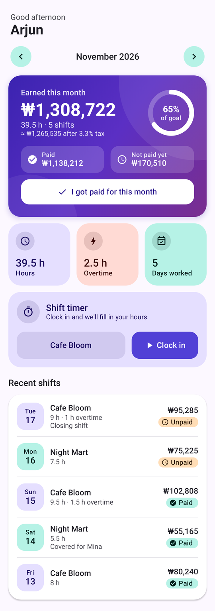
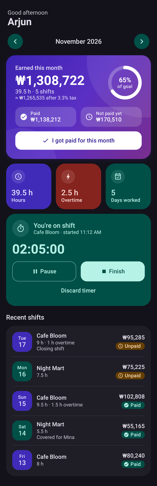
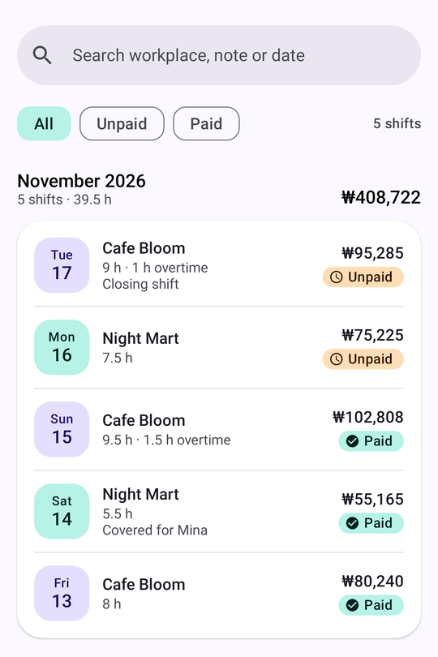

# Earninglogs

Track your shifts, hours, overtime and pay. Works fully offline. Signing in is optional and adds backup and sync across devices.

## Screenshots

<table>
  <tr>
    <th>Dashboard</th>
    <th>Dashboard (dark, on shift)</th>
    <th>Reports</th>
    <th>Shifts</th>
  </tr>
  <tr>
    <td></td>
    <td></td>
    <td></td>
    <td></td>
  </tr>
</table>

Rendered from the real screens with sample data by `ScreenshotTest` (`./gradlew testDebugUnitTest --tests "*ScreenshotTest*"`, output in `app/build/screenshots`).

## Build

Requirements: JDK 17+ (21 tested) and the Android SDK (platform 36). Android Studio is optional.

```bash
./gradlew assembleDebug        # app/build/outputs/apk/debug/app-debug.apk
./gradlew testDebugUnitTest    # unit tests
./gradlew lintRelease          # must report 0 errors
```

Sign-in and sync need `app/google-services.json`. See **SETUP.md**. Without it the app still builds and runs offline.

## Release (Google Play)

1. Create an upload keystore once:
   `keytool -genkeypair -v -keystore my-upload-key.jks -alias upload -keyalg RSA -keysize 2048 -validity 10000`
2. Set these environment variables and build the bundle:
   ```bash
   export KEYSTORE_PATH=/path/to/my-upload-key.jks STORE_PASSWORD=... KEY_PASSWORD=...   # KEY_ALIAS defaults to "upload"
   ./gradlew bundleRelease     # app/build/outputs/bundle/release/app-release.aab
   ```
3. Add the **release** SHA-1 (from Play Console → App integrity) to Firebase so Google sign-in works in the store build.
4. Bump `versionCode` / `versionName` in `app/build.gradle.kts` for every upload.

Release builds use R8 (code + resource shrinking). Keep rules are in `app/proguard-rules.pro`.

## Project layout

```
data/   Room database, repository, Firebase auth, Firestore sync, backup, shift timer
ui/     ViewModel, theme, shared components, screens (Home, Shifts, Reports, Settings)
util/   dates, currency formatting, locale-safe number input, biometrics, network status
```

`applicationId` must stay `com.aistudio.workhourstracker.pxmkzq`, because google-services.json is keyed to it.
