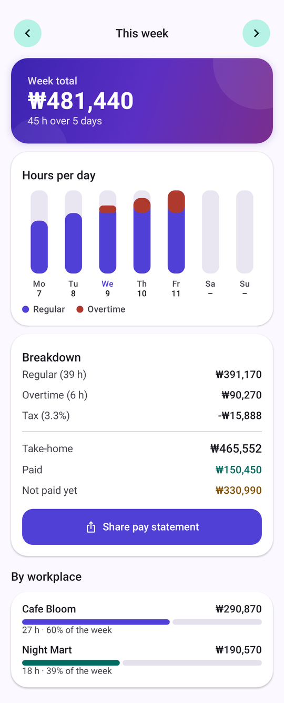

# Earninglogs

Track your shifts, hours, overtime and pay. Works fully offline. Signing in is optional and adds backup and sync across devices.

## Screenshots

<table>
  <tr>
    <th>Dashboard</th>
    <th>Dashboard (dark, on shift)</th>
    <th>Reports</th>
    <th>Shifts</th>
  </tr>
  <tr>
    <td></td>
    <td></td>
    <td></td>
    <td></td>
  </tr>
</table>

Rendered from the real screens with sample data by `ScreenshotTest` (`./gradlew testDebugUnitTest --tests "*ScreenshotTest*"`, output in `app/build/screenshots`).

## Build

Requirements: JDK 17+ (21 tested) and the Android SDK (platform 36). Android Studio is optional.

```bash
./gradlew assembleDebug        # app/build/outputs/apk/debug/app-debug.apk
./gradlew testDebugUnitTest    # unit tests
./gradlew lintRelease          # must report 0 errors
```

Sign-in and sync need `app/google-services.json`. See **SETUP.md**. Without it the app still builds and runs offline.

## Release (Google Play)

1. **Create the upload key once** (asks for a password; nothing secret is committed):
   ```bash
   powershell -ExecutionPolicy Bypass -File scripts\create-upload-key.ps1
   ```
   It saves the key to `%USERPROFILE%\.earninglogs-signing\upload-key.jks` and writes the gitignored
   `keystore.properties` that the build reads. On CI, use the `KEYSTORE_PATH`, `STORE_PASSWORD`,
   `KEY_ALIAS` and `KEY_PASSWORD` environment variables instead. **Back up the key and its password.**
2. **Build the signed bundle:**
   ```bash
   ./gradlew bundleRelease     # app/build/outputs/bundle/release/app-release.aab
   ```
   If no key is configured the build still succeeds but the output is unsigned, and Play rejects it.
   Check with `jarsigner -verify app/build/outputs/bundle/release/app-release.aab` (should print `jar verified`).
3. **Upload** the `.aab` in Play Console (Testing → Internal testing). Keep *Play App Signing* on.
4. **Firebase fingerprints** (needed for Google sign-in): add the **upload key** SHA-1
   (`keytool -list -v -keystore <key> -alias upload`) and, after the first upload, the **app signing key**
   SHA-1 from Play Console → Test and release → App integrity. Then re-download `google-services.json`.
5. Bump `versionCode` / `versionName` in `app/build.gradle.kts` for every upload.

Release builds use R8 (code + resource shrinking). Keep rules are in `app/proguard-rules.pro`.

## Project layout

```
data/   Room database, repository, Firebase auth, Firestore sync, backup, shift timer
ui/     ViewModel, theme, shared components, screens (Home, Shifts, Reports, Settings)
util/   dates, currency formatting, locale-safe number input, biometrics, network status
```

`applicationId` must stay `com.aistudio.workhourstracker.pxmkzq`, because google-services.json is keyed to it.
